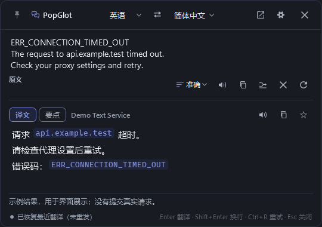
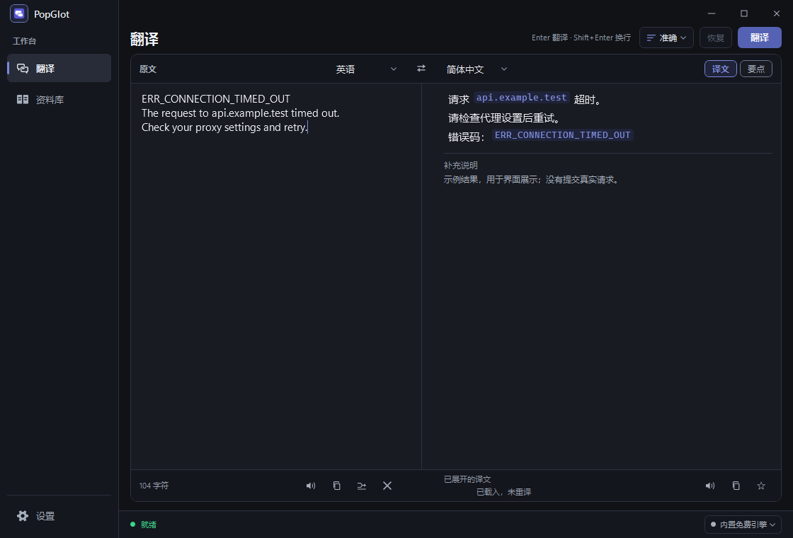
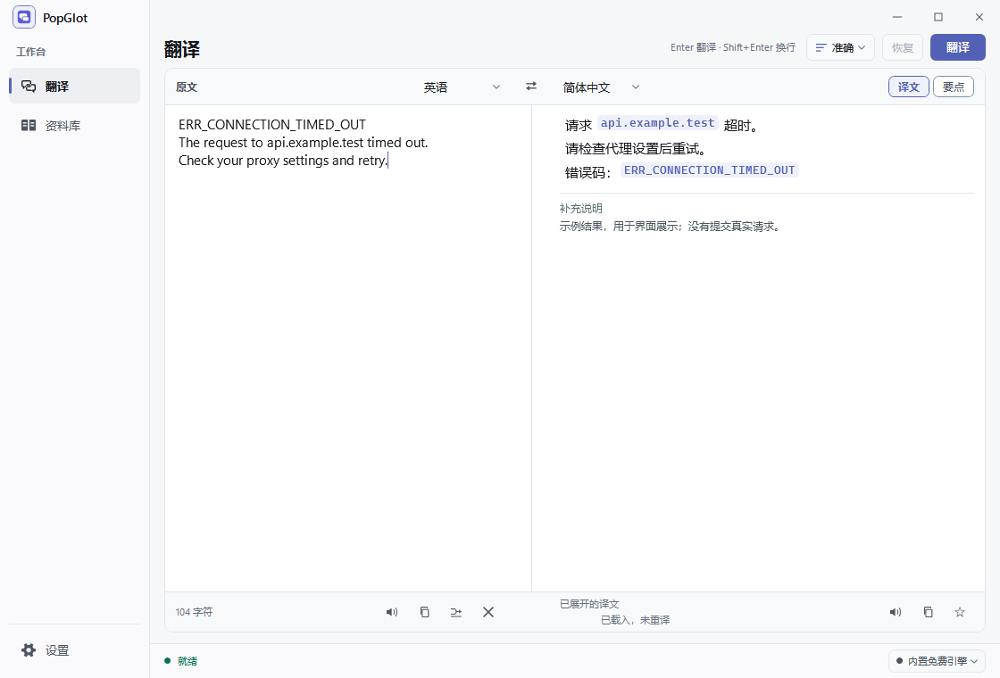
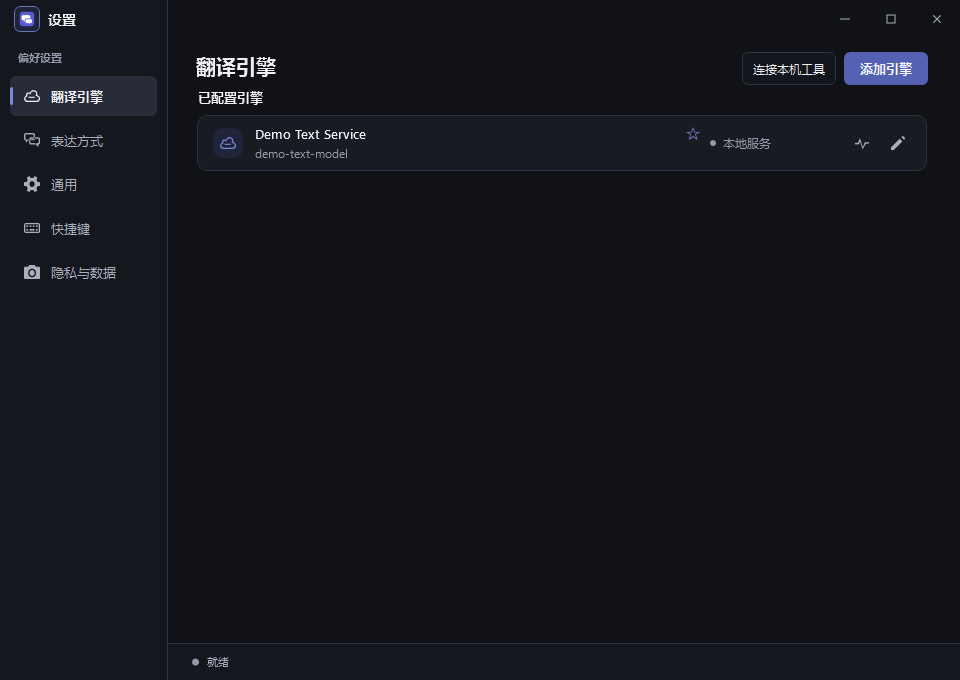

# PopGlot


Windows 桌面划词翻译。选中文字，按 `Ctrl+Alt+W`，译文出现在光标旁。面向读英文技术内容的程序员：报错、注释、命令、文档。

Select text, press `Ctrl+Alt+W`, read the translation next to the cursor. Built for programmers reading English technical content on Windows.

## 下载

两个包都自带 .NET 10 运行时，装完即用。Windows 10 / 11 x64。

[](https://github.com/ethan-blue/PopGlot/releases/download/v0.1.36/PopGlot-v0.1.36-win-x64-setup.exe)
[](https://github.com/ethan-blue/PopGlot/releases/download/v0.1.36/PopGlot-v0.1.36-win-x64.zip)

| 形态 | 文件 | 说明 |
| --- | --- | --- |
| 安装包 | `PopGlot-v0.1.36-win-x64-setup.exe`（约 57 MB） | 向导安装、开始菜单、卸载入口。升级直接跑新安装包，原地覆盖。 |
| 便携 zip | `PopGlot-v0.1.36-win-x64.zip`（约 84 MB） | 解压运行 `PopGlot.exe`，不写注册表。 |

安装包未签名，首次运行会有 SmartScreen 提示：点「更多信息」→「仍要运行」。校验文件完整性：

```powershell
(Get-FileHash .\PopGlot-v0.1.36-win-x64-setup.exe -Algorithm SHA256).Hash.ToLower()
```

和发布页同名附件的 `.sha256` 比对。全部版本见 [Releases](https://github.com/ethan-blue/PopGlot/releases)。

## 功能

| | |
| --- | --- |
| 划词 | 任意程序里 `Ctrl+Alt+W`。原剪贴板按序列号恢复。 |
| 截图 | `Ctrl+Alt+Space` 框选。默认本机 OCR，图片不出本机。 |
| 工作台 | `Ctrl+Alt+O`。左原文右译文，说明在译文下，「要点」是独立视图。 |
| 查词 | `Ctrl+Alt+Q`。输入后 Enter 翻译。 |
| 引擎 | OpenAI 兼容、OpenAI Responses、Anthropic、Gemini、Ollama、LM Studio。 |
| 免费线路 | 没配引擎时走 Google 公共翻译，可切换 MyMemory。只发待译文本。 |
| 主题 | 跟随系统 / 浅色 / 深色。 |
| 离线 | 「安全离线模式」拦截所有外发请求，本机模型地址不受影响。 |

快捷键都可以在「设置 → 快捷键」里重录，冲突时回退到保存前的组合。`Esc` 第一次取消请求，再按关闭浮窗。

## 截图识别说明

本机 OCR 用 Windows 自带的识别引擎，质量取决于系统装了哪些语言包：

- 中文 Windows 默认只带中文包，英文小字号截图识别会偏弱。版本 0.1.36 起会对小字号截图自动放大预处理，空结果自动重试。
- 识别质量不行时，到「Windows 设置 → 时间和语言 → 语言和区域」给目标语言装「光学字符识别」可选功能。
- 要更好的效果，配置视觉模型并允许截图上传（默认关闭）。

## 数据与隐私

| 数据 | 位置 |
| --- | --- |
| 配置、历史 | `%LOCALAPPDATA%\PopGlot`，不上传 |
| API Key | Windows 凭据管理器（`PopGlot/provider/<引擎id>`） |
| 日志 | 不记原文、截图、密钥 |

细节见 [docs/help/privacy-and-security.md](docs/help/privacy-and-security.md)。

## 界面



| 深色工作台 | 浅色工作台 |
| --- | --- |
|  |  |



图中的 "Demo Text Service" 是测试数据，不是内置服务。

## 上手

1. 运行 `PopGlot.exe`，程序驻留任务栏通知区。
2. 选中一段英文，按 `Ctrl+Alt+W`。第一次会走配置向导，五项选择一次做完。
3. 不配引擎也能用：免费线路默认开启，走 Google 公共翻译，不可用时切 MyMemory。
4. 要更好的质量：设置 → 引擎 → 添加引擎，填地址和 Key，测试连接后选用。
5. 要彻底断网：开「安全离线模式」，本机 Ollama / LM Studio 仍可用。

## 版本与构建

版本号 `主版本.次版本.修订号`，规则见 [docs/VERSIONING.md](docs/VERSIONING.md)，变更见 [CHANGELOG.md](CHANGELOG.md)。

构建环境：Windows 11 x64、Rust stable（msvc）、VS Build Tools 2022、.NET 10 SDK、PowerShell 7。

```powershell
./scripts/verify.ps1   # 格式 + 测试 + Clippy + WPF 构建 + 全部测试套件
./scripts/run.ps1      # 本地运行
```

代码分四块：WPF 外壳 `apps/PopGlot.Windows`，领域类型 `crates/popglot-domain`，翻译与路由 `crates/popglot-core`，C ABI `crates/popglot-ffi`。外壳可以换，翻译内核不跟着重写。结构见 [ARCHITECTURE.md](ARCHITECTURE.md)。

## 已知限制

- 只有 Windows 版。macOS / Linux 未做。
- 安装包未签名。
- 无账号、无云同步，历史只在本机。
- 免费公共线路无 SLA，重度使用请自备 Key。
- 截图视觉理解、更好的翻译质量需要自己的 API Key 或本机模型。

提需求前先看 [PRODUCT_SPEC.md](PRODUCT_SPEC.md) 的「当前未实现与明确排除」，已在计划里的不重复收。遇到问题开 Issue，贴日志前脱敏。

## 许可

[MIT](LICENSE)
